# Efficient VLM Serving

A deployment-oriented benchmark project for vision-language models
using vLLM, SGLang, quantization, and multimodal evaluation.

## Project Highlights

This project studies efficient serving of Qwen2.5-VL-3B-Instruct on a single
RTX 3090, focusing on concurrency scaling, serving backend choice, and
quantization.

### Key Results

- **vLLM concurrency scaling:** output throughput increased from
  **98.9 to 640.2 tokens/s** when concurrency increased from 1 to 16.

- **vLLM vs SGLang:** both backends showed similar single-request decode
  performance, but vLLM scaled more effectively under higher concurrency in
  the tested multimodal workload.

- **At concurrency 16:** vLLM achieved **640.2 tokens/s** compared with
  **460.7 tokens/s** for SGLang, while also providing lower median TTFT.

- **AWQ quantization:** at concurrency 8, output throughput increased from
  **452.3 to 700.4 tokens/s**, while TPOT decreased from
  **12.16 to 5.91 ms/token**.

- **Quality sanity check:** a 100-sample MME subset showed no obvious
  multimodal quality collapse after AWQ quantization.

### What This Project Covers

```text
Qwen2.5-VL-3B-Instruct
        │
        ├── vLLM serving
        │     └── concurrency scaling
        │
        ├── SGLang serving
        │     └── backend comparison
        │
        └── AWQ INT4
              ├── latency / throughput
              └── multimodal quality check
```


## Baseline Model

- Qwen/Qwen2.5-VL-3B-Instruct

## Current Hardware

- NVIDIA GeForce RTX 3090
- 24 GB VRAM

## Progress

### Day 1 — vLLM Baseline

- [x] Created isolated Python environment
- [x] Installed CUDA 12.9 build of PyTorch and vLLM
- [x] Launched Qwen2.5-VL-3B-Instruct with vLLM
- [x] Verified OpenAI-compatible API endpoint
- [x] Sent a local image through the API
- [x] Received a correct multimodal response

## Planned Work

- vLLM performance benchmarking
- SGLang performance benchmarking
- BF16 vs quantized inference
- Multimodal quality evaluation
- Quality / latency / throughput / memory trade-off analysis


## Day 2 — vLLM Concurrency Benchmark

### Objective

The goal of Day 2 is to characterize the throughput-latency trade-off of
serving a vision-language model with vLLM under different request concurrency
levels.

The experiment focuses on a single controlled variable:

**maximum request concurrency**.

All other model, input, decoding, and server configurations are kept fixed.

---

### Experimental Setup

#### Model

- Qwen/Qwen2.5-VL-3B-Instruct
- Precision: BF16
- Serving backend: vLLM
- OpenAI-compatible chat completion API

#### Hardware

- NVIDIA GeForce RTX 3090
- 24 GB VRAM
- CUDA Toolkit 12.9
- PyTorch 2.13.0+cu129
- vLLM 0.30.0+cu129

#### Server Configuration

```bash
vllm serve Qwen/Qwen2.5-VL-3B-Instruct \
    --host 127.0.0.1 \
    --port 8000 \
    --max-model-len 4096 \
    --gpu-memory-utilization 0.80 \
    --limit-mm-per-prompt '{"image":1,"video":0}' \
    --no-enable-prefix-caching
```

Prefix caching is disabled to avoid artificially improving repeated benchmark
requests through prefix KV-cache reuse.

#### Benchmark Workload

- Number of measured requests: 128
- Warm-up requests executed before each formal benchmark
- One image per request
- Image resolution: 640 × 640
- Fixed text prompt
- Output length: 128 tokens
- Temperature: 0
- EOS ignored to keep output length consistent
- Request rate: unlimited (`inf`)
- Concurrency levels: 1, 4, 8, 16

The benchmark dataset contains 128 image-prompt pairs. Images are kept at the
same resolution while being made byte-wise distinct to reduce unintended
multimodal cache reuse.

#### Metrics

The following serving metrics are measured:

- Request throughput
- Output token throughput
- Time to First Token (TTFT)
- Time per Output Token (TPOT)
- Inter-token Latency (ITL)
- End-to-End Latency (E2E)
- Peak GPU memory usage
- GPU utilization
- Request failure rate

GPU statistics are sampled every 200 ms using `nvidia-smi`.

---

### Results

| Concurrency | Request Throughput (req/s) | Output Throughput (tok/s) | TTFT P50 (ms) | TTFT P95 (ms) | Mean TPOT (ms/token) | Mean E2E (ms) | Peak VRAM (MiB) |
|---:|---:|---:|---:|---:|---:|---:|---:|
| 1  | 0.77 | 98.92  | 165.7  | 171.2  | 8.94  | 1293.3 | 18111 |
| 4  | 2.18 | 279.61 | 507.7  | 517.9  | 11.05 | 1828.7 | 18111 |
| 8  | 3.53 | 452.33 | 644.0  | 951.6  | 12.16 | 2262.0 | 18111 |
| 16 | 5.00 | 640.20 | 1184.0 | 1782.0 | 15.81 | 3194.7 | 18167 |

All 128 requests completed successfully at every tested concurrency level.

---

### Benchmark Figures

#### Output Throughput

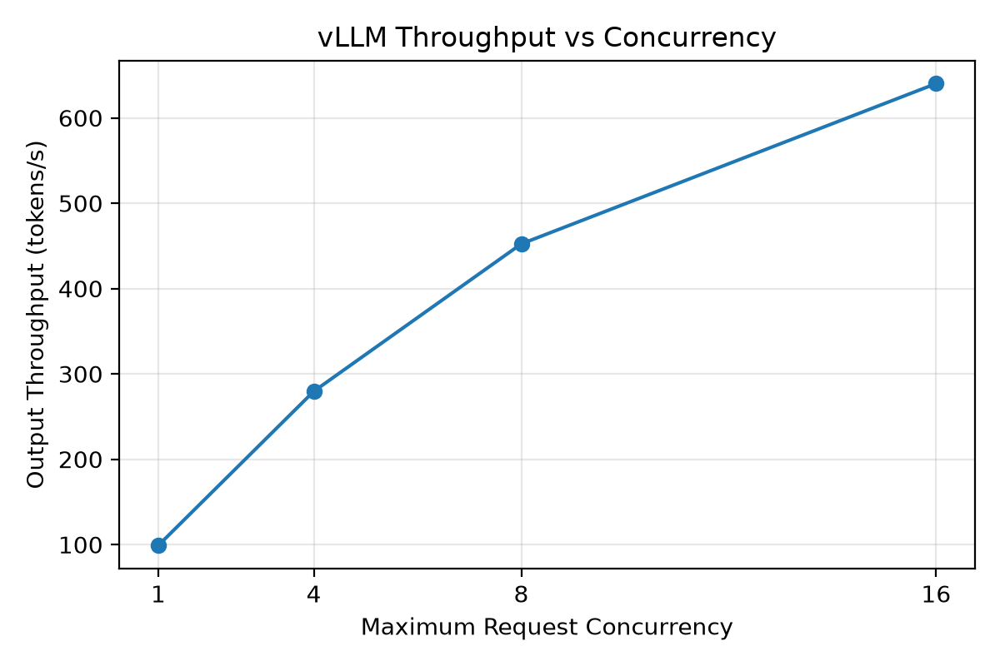

#### Time to First Token

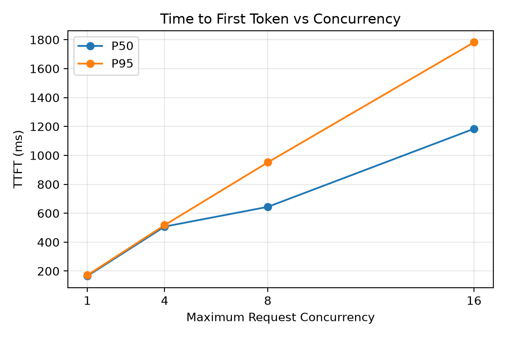

#### Time per Output Token

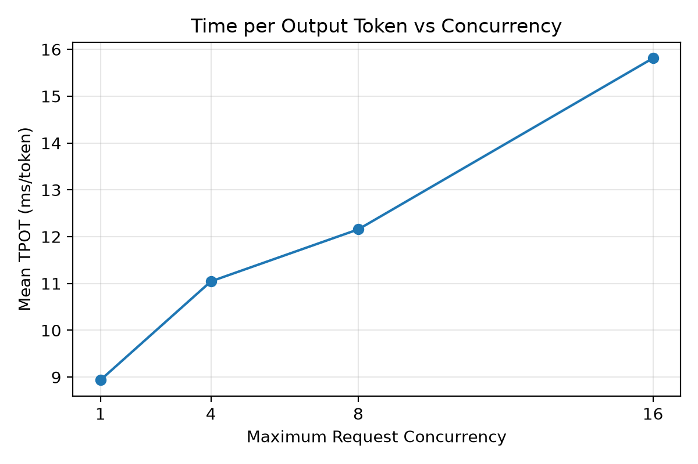

#### End-to-End Latency

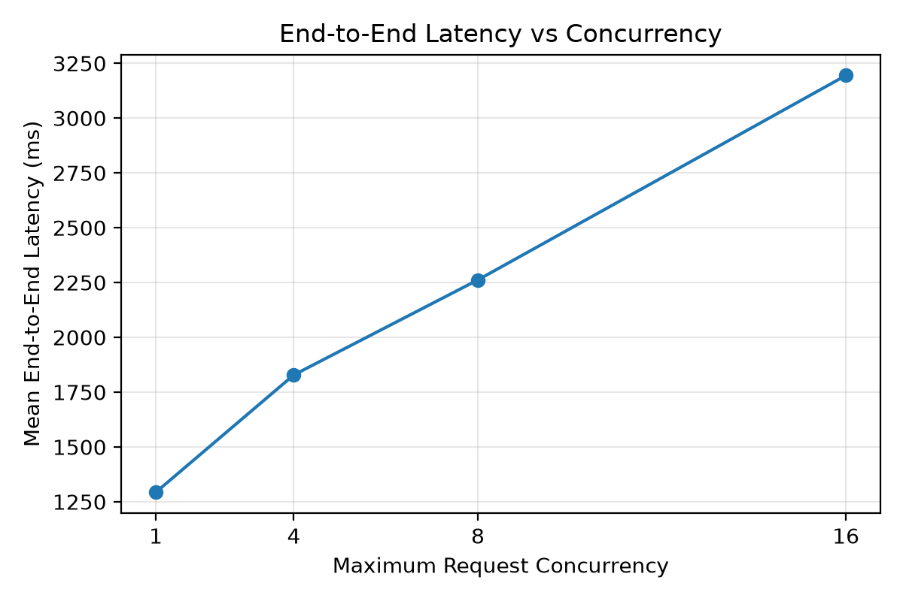

#### Throughput–Latency Trade-off

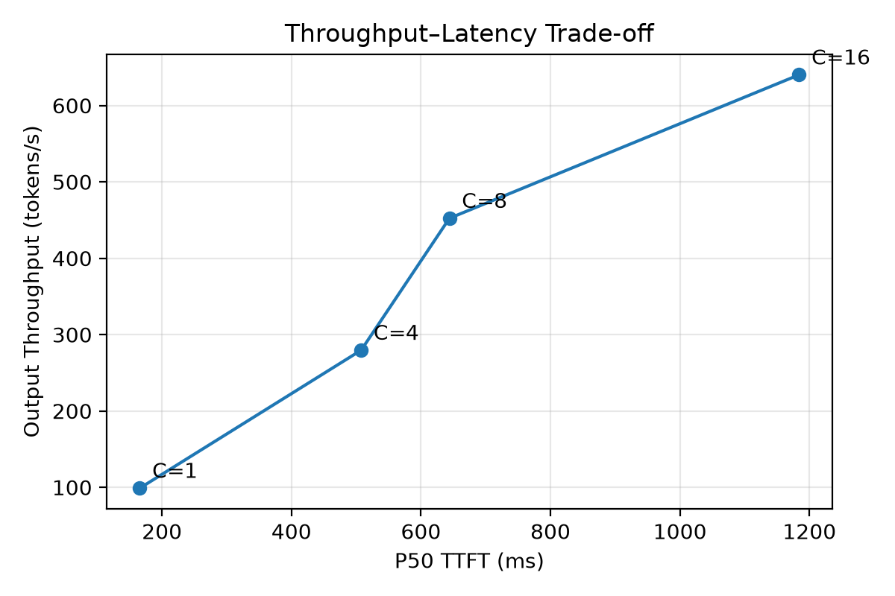

---

### Analysis

#### Throughput Scaling

Increasing request concurrency substantially improves aggregate serving
throughput.

Relative to concurrency 1:

| Concurrency | Output Throughput (tok/s) | Relative Throughput |
|---:|---:|---:|
| 1  | 98.92  | 1.00× |
| 4  | 279.61 | 2.83× |
| 8  | 452.33 | 4.57× |
| 16 | 640.20 | 6.47× |

The throughput gain is clearly sub-linear. Increasing concurrency enables vLLM
to batch more requests together and process more tokens in parallel, but
doubling concurrency does not result in a proportional doubling of throughput.

For example, increasing concurrency from 8 to 16 improves output throughput
from 452.33 to 640.20 tokens/s, corresponding to an increase of approximately
41.5%.

This indicates diminishing throughput gains as the system is pushed toward
higher concurrency.

#### Throughput–Latency Trade-off

The increase in throughput comes at the cost of higher per-request latency.

Median TTFT increases substantially with concurrency:

| Concurrency | TTFT P50 (ms) | TTFT P95 (ms) |
|---:|---:|---:|
| 1  | 165.7  | 171.2  |
| 4  | 507.7  | 517.9  |
| 8  | 644.0  | 951.6  |
| 16 | 1184.0 | 1782.0 |

The transition from concurrency 8 to 16 is particularly notable:

- Output throughput increases by approximately **41.5%**
- Median TTFT increases by approximately **83.9%**
- Mean E2E latency increases by approximately **41.2%**
- Mean TPOT increases from **12.16 ms/token to 15.81 ms/token**

Therefore, higher concurrency continues to improve aggregate throughput, but
the marginal throughput gain becomes increasingly expensive in terms of
user-facing latency.

For this specific model, hardware configuration, and workload, concurrency
around 8 appears to be an observed knee of the throughput-latency curve.

This should not be interpreted as a universally optimal concurrency level.
The appropriate operating point depends on the latency requirements and
throughput objectives of the target application.

#### Understanding TPOT

TPOT measures the average time required to generate each output token after
the first token has been produced.

TPOT increases from:

- 8.94 ms/token at concurrency 1
- 11.05 ms/token at concurrency 4
- 12.16 ms/token at concurrency 8
- 15.81 ms/token at concurrency 16

This means that individual requests generate tokens more slowly as concurrency
increases.

However, the server is simultaneously generating tokens for more requests.
As a result, aggregate output throughput increases even though per-request
token generation latency becomes worse.

This distinction illustrates an important serving-system trade-off:

**lower per-request latency and higher aggregate throughput are different
optimization objectives.**

#### GPU Behavior

Peak GPU memory usage remains nearly constant across concurrency levels:

| Concurrency | Peak VRAM (MiB) |
|---:|---:|
| 1  | 18111 |
| 4  | 18111 |
| 8  | 18111 |
| 16 | 18167 |

This behavior is expected because vLLM reserves a substantial GPU memory pool
for model weights, KV cache, CUDA graphs, and runtime workspaces according to
the configured GPU memory utilization limit.

Therefore, increasing request concurrency does not directly produce a
proportional increase in total allocated GPU memory.

During active inference periods, `nvidia-smi` reports approximately 97% GPU
utilization across the tested concurrency levels.

However, this metric should be interpreted carefully.

`nvidia-smi` GPU utilization primarily indicates whether GPU kernels are active
during a sampling interval. It does not directly measure:

- SM occupancy
- Tensor Core utilization
- achieved FLOPS
- memory bandwidth utilization
- overall computational efficiency

Therefore, high GPU utilization at concurrency 1 does not imply that the GPU's
full compute capacity is already efficiently utilized.

At low concurrency, the GPU may execute kernels almost continuously while the
individual operations remain relatively small.

Higher concurrency allows vLLM to form larger batches and exploit GPU
parallelism more effectively.

This is reflected directly in the throughput results:

- Concurrency 1: **98.92 output tokens/s**
- Concurrency 8: **452.33 output tokens/s**
- Concurrency 16: **640.20 output tokens/s**

Thus, similar `nvidia-smi` utilization values can correspond to very different
levels of useful serving throughput.

#### Tail Latency

The benchmark also shows that latency variation becomes more pronounced at
higher concurrency.

For example, at concurrency 16:

- TTFT P50: **1184.0 ms**
- TTFT P95: **1782.0 ms**

The difference between median and tail latency indicates that some requests
experience substantially longer waiting time under higher server load.

For an online serving system, this is important because average latency alone
does not fully describe user experience. Tail metrics such as P95 and P99 are
therefore important when evaluating deployment configurations.

---

### Key Findings

1. **Continuous batching substantially improves aggregate throughput.**

   Increasing concurrency from 1 to 16 improves output throughput from
   98.92 to 640.20 tokens/s, corresponding to a **6.47× increase**.

2. **Throughput scaling is sub-linear.**

   Higher concurrency continues to improve throughput, but the marginal gain
   decreases as concurrency increases.

3. **Higher throughput comes with higher latency.**

   TTFT, TPOT, and E2E latency all increase as more requests are processed
   concurrently.

4. **Concurrency 8 represents an observed throughput-latency knee for this
   workload.**

   Increasing concurrency from 8 to 16 provides approximately 41.5% more
   output throughput, while median TTFT increases by approximately 83.9%.

5. **High `nvidia-smi` utilization does not necessarily imply full compute
   efficiency.**

   The GPU can remain continuously active even when relatively small kernels
   do not fully exploit its available parallelism. Larger serving batches can
   therefore improve throughput even when reported GPU utilization is already
   close to 100%.

6. **Peak VRAM usage is largely insensitive to request concurrency.**

   vLLM pre-allocates a substantial GPU memory pool, so changes in concurrency
   mainly affect scheduling and compute behavior rather than total allocated
   memory.

7. **The server remained stable under the tested workload.**

   All 128 requests completed successfully at every tested concurrency level,
   with no failed requests.

---

### Reproducing the Experiment

#### 1. Activate the Environment

```bash
source .venv-vllm/bin/activate
source scripts/use_cuda_12_9.sh
```

#### 2. Prepare the Benchmark Dataset

```bash
python scripts/prepare_day2_dataset.py
```

The generated benchmark dataset is stored at:

```text
assets/day2_benchmark.jsonl
```

#### 3. Start the vLLM Server

```bash
vllm serve Qwen/Qwen2.5-VL-3B-Instruct \
    --host 127.0.0.1 \
    --port 8000 \
    --max-model-len 4096 \
    --gpu-memory-utilization 0.80 \
    --limit-mm-per-prompt '{"image":1,"video":0}' \
    --no-enable-prefix-caching
```

#### 4. Run the Concurrency Benchmark

In another terminal:

```bash
source .venv-vllm/bin/activate
source scripts/use_cuda_12_9.sh

./scripts/run_vllm_concurrency_benchmark.sh
```

The benchmark evaluates:

```text
concurrency = 1, 4, 8, 16
```

with 128 measured requests for each configuration.

#### 5. Aggregate the Results

```bash
python src/aggregate_results.py
```

The processed results are written to:

```text
results/processed/vllm_bf16_concurrency_final.csv
```

#### 6. Generate Benchmark Figures

```bash
python src/plot_results.py
```

Generated figures are stored under:

```text
results/figures/
```

---

### Day 2 Summary

Day 2 establishes the first controlled serving benchmark for the project.

The experiment demonstrates that increasing request concurrency allows vLLM
to achieve substantially higher aggregate VLM throughput through batching, but
the improvement comes with increasingly higher TTFT, TPOT, and end-to-end
latency.

The results establish a BF16 vLLM baseline that will be used for subsequent
backend and optimization comparisons.


## Day 3 — SGLang Multimodal Serving Baseline

### Objective

The goal of Day 3 is to deploy the same vision-language model used in the
vLLM baseline with SGLang and verify multimodal inference through an
OpenAI-compatible API.

This establishes a second serving backend for the later controlled comparison.

---

### Environment

#### Model

- Qwen/Qwen2.5-VL-3B-Instruct
- Precision: BF16
- Serving backend: SGLang
- OpenAI-compatible chat completion API

#### Hardware

- NVIDIA GeForce RTX 3090
- 24 GB VRAM
- CUDA Toolkit 12.9

#### SGLang Environment

- SGLang 0.5.10.post1
- PyTorch 2.9.1+cu128
- Python 3.12
- GCC/G++ 10 for JIT CUDA kernel compilation

SGLang's JIT kernels require C++20 support. The host operating system defaults
to GCC 9, which failed to compile kernels using the `<concepts>` header.

The SGLang environment therefore explicitly uses GCC/G++ 10:

```bash
export CC=/usr/bin/gcc-10
export CXX=/usr/bin/g++-10
export CUDAHOSTCXX=/usr/bin/g++-10
export NVCC_CCBIN=/usr/bin/g++-10
```

These settings are isolated to the SGLang project environment and do not
modify the system-wide compiler configuration.

---

### Server Configuration

The SGLang server is launched with:

```bash
python -m sglang.launch_server \
    --model-path Qwen/Qwen2.5-VL-3B-Instruct \
    --host 127.0.0.1 \
    --port 30000 \
    --dtype bfloat16 \
    --context-length 4096 \
    --mem-fraction-static 0.80 \
    --disable-radix-cache
```

Radix cache is disabled so that repeated benchmark prompts do not benefit from
prefix reuse.

---

### Multimodal Smoke Test

A multimodal request containing a local image and text prompt was sent through
the OpenAI-compatible `/v1/chat/completions` endpoint.

The model successfully generated a correct description of the image,
confirming the complete serving path:

```text
image + text
    ↓
SGLang
    ↓
Qwen2.5-VL-3B-Instruct
    ↓
OpenAI-compatible API
    ↓
text response
```

This establishes the SGLang BF16 deployment baseline used in Day 4.

---

## Day 4 — vLLM vs SGLang Serving Comparison

### Objective

The goal of Day 4 is to compare the concurrency scaling behavior of vLLM and
SGLang under the same multimodal serving workload.

Rather than using each framework's native benchmark utility independently,
both backends are evaluated using the same benchmark client and the same
request dataset.

This reduces client-side and workload differences and makes the comparison
more controlled.

---

### Experimental Methodology

The following properties are kept consistent between the two benchmark runs:

| Configuration | vLLM | SGLang |
|---|---|---|
| Model | Qwen2.5-VL-3B-Instruct | Qwen2.5-VL-3B-Instruct |
| Precision | BF16 | BF16 |
| GPU | RTX 3090 | RTX 3090 |
| Input images | Same dataset | Same dataset |
| Image resolution | 640 × 640 | 640 × 640 |
| Images per request | 1 | 1 |
| Measured requests | 128 | 128 |
| Output length | 128 tokens | 128 tokens |
| Temperature | 0 | 0 |
| EOS handling | Ignored | Ignored |
| Request rate | Unlimited | Unlimited |
| Concurrency | 1, 4, 8, 16 | 1, 4, 8, 16 |
| Prefix caching | Disabled | Disabled |
| Benchmark client | `vllm bench serve` | `vllm bench serve` |

The serving frameworks use their respective software stacks and memory
management implementations, so this experiment should be interpreted as an
end-to-end serving comparison rather than a kernel-level comparison.

---

### Benchmark Results

| Concurrency | vLLM Output Throughput (tok/s) | SGLang Output Throughput (tok/s) | vLLM TTFT P50 (ms) | SGLang TTFT P50 (ms) | vLLM TPOT (ms/token) | SGLang TPOT (ms/token) |
|---:|---:|---:|---:|---:|---:|---:|
| 1  | 98.92  | 96.53  | 165.7  | 232.5  | 8.94  | 8.68 |
| 4  | 279.61 | 242.47 | 507.7  | 838.1  | 11.05 | 10.64 |
| 8  | 452.33 | 355.71 | 644.0  | 1450.4 | 12.16 | 11.73 |
| 16 | 640.20 | 460.70 | 1184.0 | 2240.8 | 15.81 | 16.61 |

Both serving backends completed all 128 requests successfully at every tested
concurrency level.

---

### Full Latency and Memory Comparison

| C | Backend | Req/s | Output tok/s | TTFT P50 (ms) | TTFT P95 (ms) | Mean TPOT (ms/token) | Mean E2E (ms) | Peak VRAM (MiB) |
|---:|---|---:|---:|---:|---:|---:|---:|---:|
| 1 | vLLM | 0.77 | 98.92 | 165.7 | 171.2 | 8.94 | 1293.3 | 18111 |
| 1 | SGLang | 0.75 | 96.53 | 232.5 | 234.1 | 8.68 | 1325.8 | 20790 |
| 4 | vLLM | 2.18 | 279.61 | 507.7 | 517.9 | 11.05 | 1828.7 | 18111 |
| 4 | SGLang | 1.89 | 242.47 | 838.1 | 844.4 | 10.64 | 2110.5 | 20898 |
| 8 | vLLM | 3.53 | 452.33 | 644.0 | 951.6 | 12.16 | 2262.0 | 18111 |
| 8 | SGLang | 2.78 | 355.71 | 1450.4 | 1618.4 | 11.73 | 2876.4 | 21006 |
| 16 | vLLM | 5.00 | 640.20 | 1184.0 | 1782.0 | 15.81 | 3194.7 | 18167 |
| 16 | SGLang | 3.60 | 460.70 | 2240.8 | 3191.1 | 16.61 | 4441.4 | 21036 |

---

### Backend Comparison Figures

#### Output Throughput

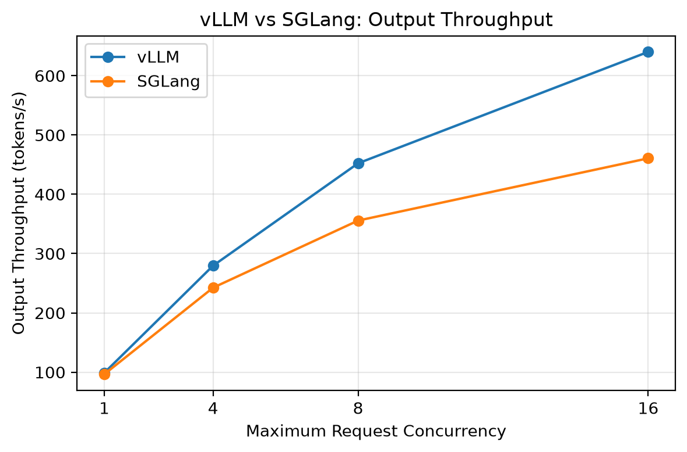

#### Median Time to First Token

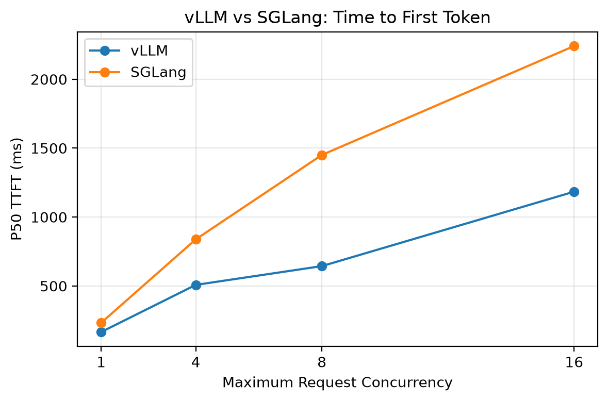

#### P95 Time to First Token

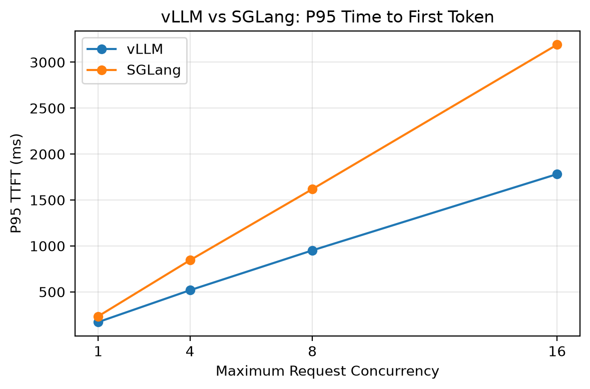

#### Time per Output Token

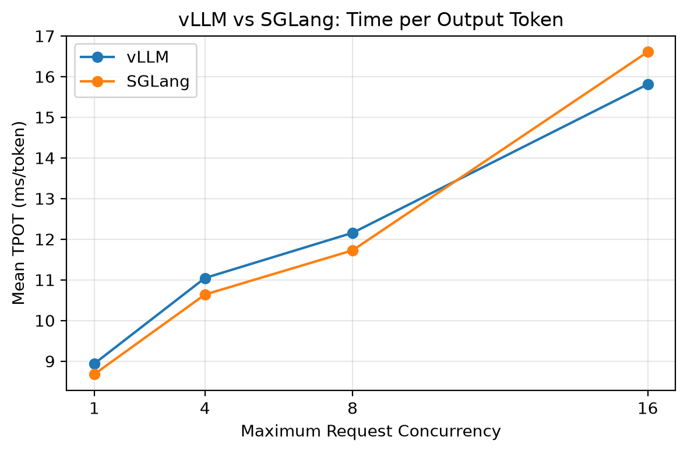

#### End-to-End Latency

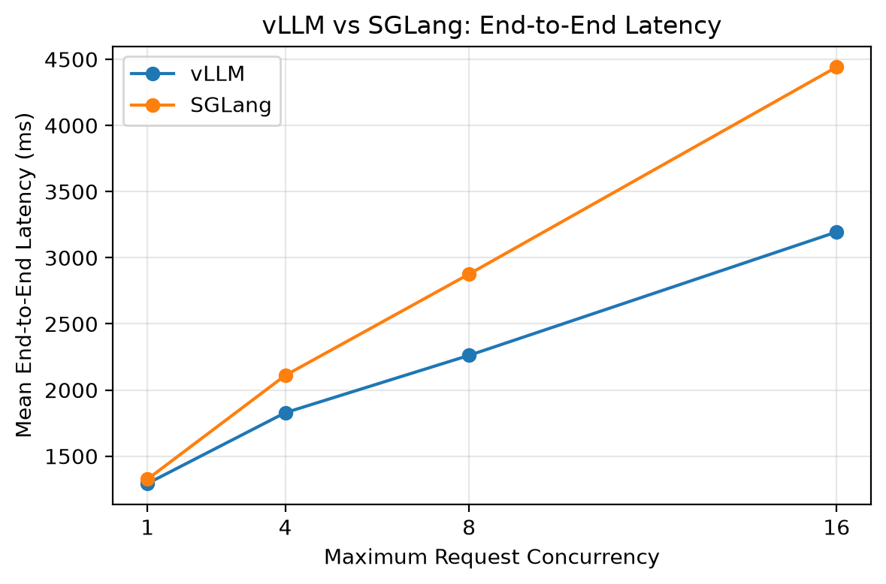

#### Peak GPU Memory

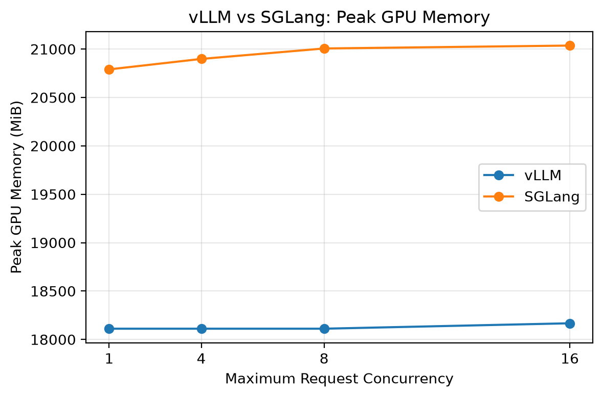

#### Throughput–Latency Trade-off

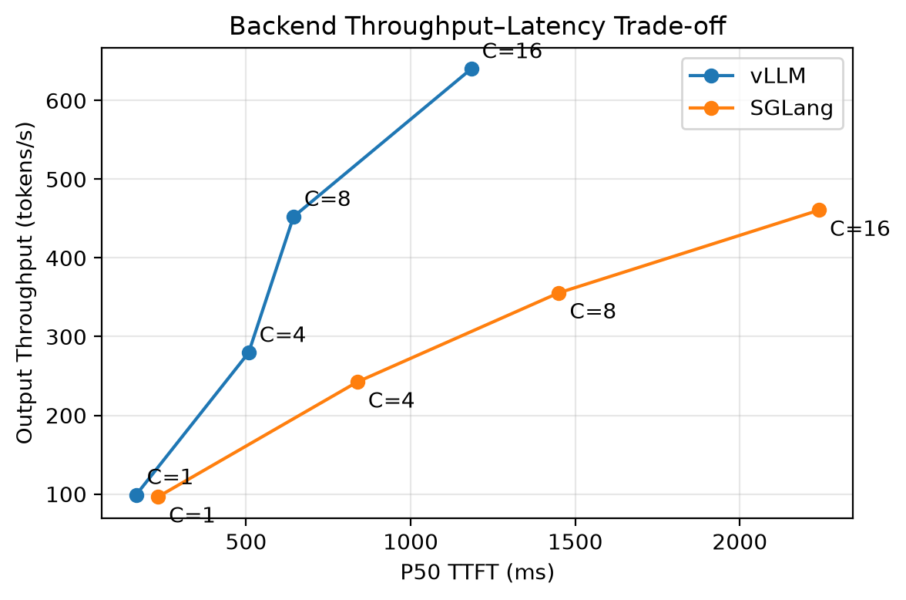

---

### Analysis

#### 1. Single-Request Performance Is Similar

At concurrency 1, the two serving backends achieve very similar output
throughput:

```text
vLLM:    98.92 tokens/s
SGLang:  96.53 tokens/s
```

Their TPOT values are also very close:

```text
vLLM:    8.94 ms/token
SGLang:  8.68 ms/token
```

This suggests that the two backends have broadly comparable steady-state
decode performance for a single active request in this workload.

The more noticeable difference at concurrency 1 is TTFT:

```text
vLLM:    165.7 ms
SGLang:  232.5 ms
```

---

#### 2. The Throughput Gap Increases with Concurrency

The serving behavior begins to diverge as request concurrency increases.

At concurrency 4:

```text
vLLM:    279.61 tokens/s
SGLang:  242.47 tokens/s
```

At concurrency 8:

```text
vLLM:    452.33 tokens/s
SGLang:  355.71 tokens/s
```

At concurrency 16:

```text
vLLM:    640.20 tokens/s
SGLang:  460.70 tokens/s
```

The results therefore indicate that, for this particular multimodal workload,
vLLM scales more effectively as the number of simultaneous requests
increases.

This observation is workload- and hardware-specific and should not be
interpreted as a universal ranking of the two serving frameworks.

---

#### 3. The Largest Difference Appears in TTFT

The difference between the two systems is substantially larger for TTFT than
for TPOT.

At concurrency 8:

```text
TTFT P50
vLLM:     644.0 ms
SGLang:  1450.4 ms

TPOT
vLLM:     12.16 ms/token
SGLang:   11.73 ms/token
```

At concurrency 16:

```text
TTFT P50
vLLM:    1184.0 ms
SGLang:  2240.8 ms

TPOT
vLLM:     15.81 ms/token
SGLang:   16.61 ms/token
```

Steady-state token generation latency remains relatively similar between the
two systems, while first-token latency diverges substantially at higher
concurrency.

This suggests that the observed serving gap is concentrated more heavily in
the first-token / high-concurrency path than in autoregressive decode alone.

Possible contributors include request scheduling, multimodal preprocessing,
vision encoding, prefill batching, or backend-specific execution behavior.
Identifying the exact cause would require lower-level profiling and is outside
the scope of this benchmark.

---

#### 4. End-to-End Latency Reflects the TTFT Difference

The TTFT gap directly affects total request latency.

At concurrency 16:

```text
Mean E2E

vLLM:    3194.7 ms
SGLang:  4441.4 ms
```

Because both systems produce 128 output tokens per request, the relatively
similar TPOT values cannot fully explain this difference.

The larger first-token delay therefore contributes substantially to SGLang's
higher end-to-end latency in this experiment.

---

#### 5. GPU Memory Behavior Differs Between Backends

Peak GPU memory usage also differs consistently:

```text
Concurrency 1

vLLM:    18111 MiB
SGLang:  20790 MiB
```

and:

```text
Concurrency 16

vLLM:    18167 MiB
SGLang:  21036 MiB
```

The difference should not be interpreted simply as model-weight overhead.

Both serving frameworks independently manage:

- KV cache allocation
- memory pools
- CUDA graphs
- runtime workspaces
- multimodal model components

Therefore, these numbers represent the peak GPU memory footprint of the tested
serving configurations rather than an intrinsic memory requirement of each
framework.

---

#### 6. GPU Utilization Alone Does Not Explain Throughput

Both systems frequently report high active-sample GPU utilization.

However, as observed in Day 2, `nvidia-smi` utilization primarily indicates
whether kernels are active during a sampling interval and does not directly
measure GPU computational efficiency.

High reported utilization therefore does not imply equal:

- SM occupancy
- Tensor Core utilization
- memory bandwidth utilization
- achieved FLOPS
- batching efficiency

The serving throughput measurements provide a more useful end-to-end metric
for this experiment.

---

### Key Findings

1. **vLLM and SGLang provide similar single-request decode performance.**

   At concurrency 1, output throughput and TPOT are very close between the two
   systems.

2. **Their scaling behavior diverges as concurrency increases.**

   vLLM achieves progressively higher aggregate throughput relative to SGLang
   at concurrency 4, 8, and 16.

3. **TTFT is the largest observed latency difference.**

   SGLang's median TTFT grows substantially faster than vLLM's under higher
   concurrency.

4. **TPOT remains comparatively similar.**

   The smaller TPOT difference suggests that steady-state autoregressive decode
   is not the primary source of the overall serving gap.

5. **vLLM achieves lower end-to-end latency at higher concurrency in this
   workload.**

   The first-token latency difference contributes substantially to the total
   request latency difference.

6. **The tested SGLang configuration has a larger peak GPU memory footprint.**

   This reflects framework-specific memory management and cache allocation and
   should not be generalized beyond the tested configuration.

7. **Both backends are stable under the tested workload.**

   All 128 requests completed successfully at every tested concurrency level.

---

### Reproducing the SGLang Benchmark

Activate the benchmark client environment:

```bash
source .venv-vllm/bin/activate
source scripts/use_cuda_12_9.sh
```

Run the SGLang concurrency benchmark:

```bash
./scripts/run_sglang_concurrency_benchmark.sh
```

Aggregate the results:

```bash
python src/aggregate_sglang_results.py
```

Generate backend comparison figures:

```bash
python src/plot_backend_comparison.py
```

Processed results are stored in:

```text
results/processed/
├── vllm_bf16_concurrency_final.csv
└── sglang_bf16_concurrency_final.csv
```

Comparison figures are stored in:

```text
results/figures/backend_comparison/
```

---

### Day 4 Summary

The controlled backend comparison shows that vLLM and SGLang have similar
single-request decode performance for Qwen2.5-VL-3B-Instruct, but their serving
behavior diverges under increasing concurrency.

In the tested RTX 3090 BF16 multimodal workload, vLLM maintains lower TTFT and
higher aggregate throughput as concurrency increases, while TPOT remains
relatively similar between the two systems.

The results demonstrate why evaluating an inference backend requires more than
a single tokens-per-second measurement: request scheduling, first-token
latency, batching behavior, end-to-end latency, and GPU memory footprint all
contribute to practical serving performance.


## Day 5 — BF16 vs AWQ INT4 Quantization

### Objective

The goal of Day 5 is to evaluate how AWQ 4-bit weight quantization affects
multimodal serving performance compared with the BF16 baseline.

The experiment focuses on the trade-off between:

- output throughput
- time to first token
- decode latency
- end-to-end latency
- GPU memory usage
- output quality

The serving backend is kept fixed to vLLM so that the primary experimental
variable is model precision.

---

### Models

#### BF16 Baseline

```text
Qwen/Qwen2.5-VL-3B-Instruct
```

#### AWQ Quantized Model

```text
Qwen/Qwen2.5-VL-3B-Instruct-AWQ
```

The AWQ checkpoint uses 4-bit weight quantization for supported language-model
layers while keeping the multimodal model functional through the same
OpenAI-compatible serving interface.

A multimodal smoke test using the same local image as the BF16 baseline
produced a correct image description, confirming that the quantized model
remains functional for vision-language inference.

---

### Experimental Setup

The benchmark reuses the controlled serving workload established in Day 2.

| Configuration | BF16 | AWQ |
|---|---|---|
| Backend | vLLM | vLLM |
| GPU | RTX 3090 | RTX 3090 |
| Model family | Qwen2.5-VL-3B | Qwen2.5-VL-3B |
| Image resolution | 640 × 640 | 640 × 640 |
| Images per request | 1 | 1 |
| Measured requests | 128 | 128 |
| Output length | 128 tokens | 128 tokens |
| Temperature | 0 | 0 |
| Prefix caching | Disabled | Disabled |
| GPU memory utilization target | 0.80 | 0.80 |
| Concurrency | 1, 8, 16 | 1, 8, 16 |

Concurrency 1 represents single-request latency, concurrency 8 corresponds to
the throughput-latency knee observed in the BF16 experiment, and concurrency
16 represents the high-concurrency regime.

---

### Results

| C | Precision | Output Throughput (tok/s) | TTFT P50 (ms) | TTFT P95 (ms) | Mean TPOT (ms/token) | Mean E2E (ms) | Peak VRAM (MiB) |
|---:|---|---:|---:|---:|---:|---:|---:|
| 1 | BF16 | 98.92 | 165.7 | 171.2 | 8.94 | 1293.3 | 18111 |
| 1 | AWQ | 187.03 | 150.8 | 164.9 | 4.23 | 684.1 | 17968 |
| 8 | BF16 | 452.33 | 644.0 | 951.6 | 12.16 | 2262.0 | 18111 |
| 8 | AWQ | 700.41 | 659.9 | 922.1 | 5.91 | 1460.9 | 18207 |
| 16 | BF16 | 640.20 | 1184.0 | 1782.0 | 15.81 | 3194.7 | 18167 |
| 16 | AWQ | 845.74 | 1067.1 | 1785.0 | 9.67 | 2418.7 | 18207 |

All benchmark requests completed successfully.

---

### Quantization Comparison Figures

#### Output Throughput

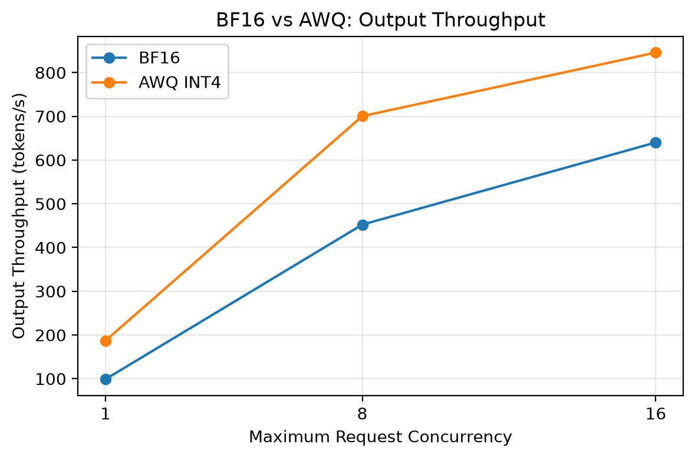

#### Time to First Token

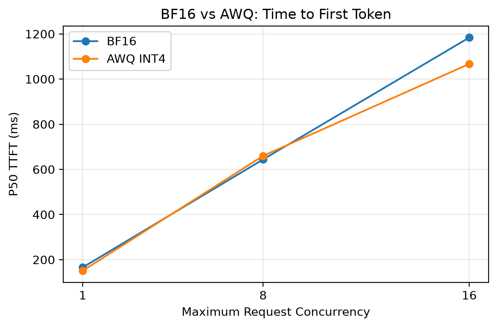

#### Time per Output Token

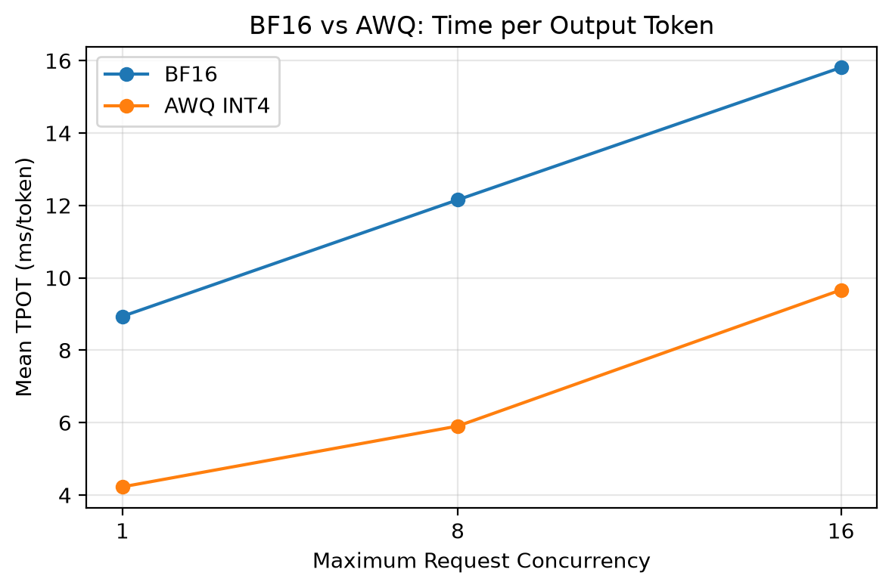

#### End-to-End Latency

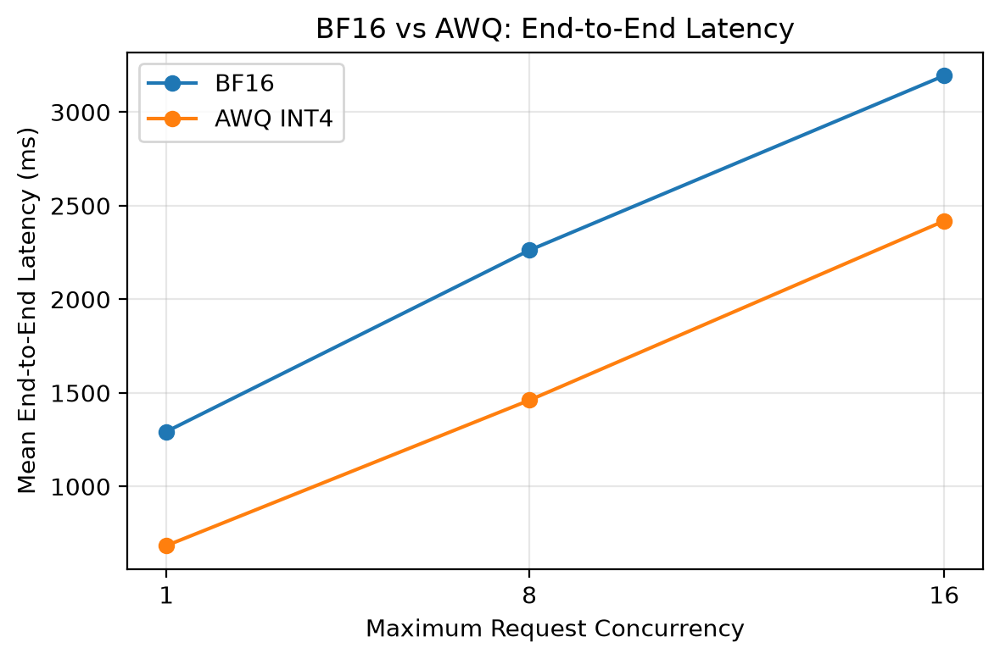

#### Peak GPU Memory

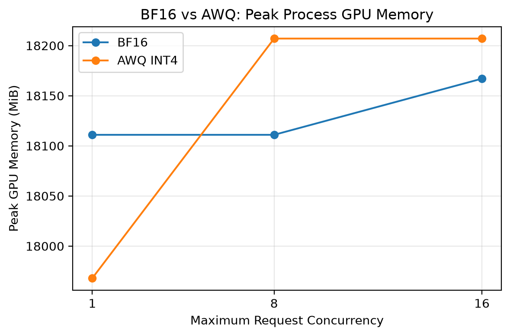

#### Throughput–Latency Trade-off

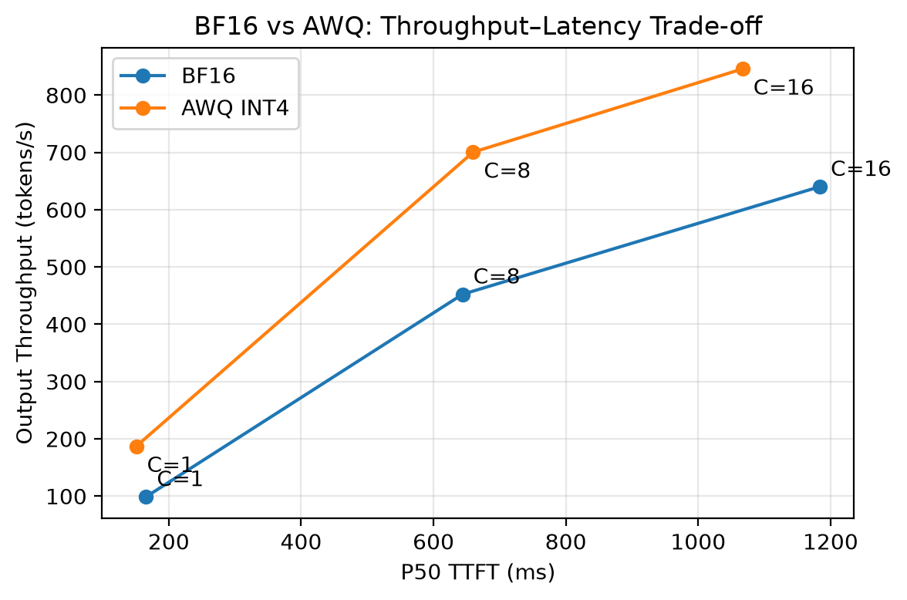

---

### Analysis

#### 1. AWQ Substantially Improves Decode Throughput

The largest performance difference appears in output token generation.

At concurrency 1:

```text
BF16:  98.92 tokens/s
AWQ:  187.03 tokens/s
```

This corresponds to approximately an **89% increase** in output throughput.

At concurrency 8:

```text
BF16:  452.33 tokens/s
AWQ:   700.41 tokens/s
```

The throughput improvement is approximately **55%**.

At concurrency 16:

```text
BF16:  640.20 tokens/s
AWQ:   845.74 tokens/s
```

The throughput improvement remains approximately **32%** under high
concurrency.

The relative performance gain decreases as concurrency increases, but AWQ
remains faster than the BF16 baseline at every tested operating point.

---

#### 2. TPOT Shows the Clearest Quantization Benefit

The most consistent improvement appears in Time per Output Token.

```text
Concurrency 1
BF16:  8.94 ms/token
AWQ:   4.23 ms/token

Concurrency 8
BF16: 12.16 ms/token
AWQ:   5.91 ms/token

Concurrency 16
BF16: 15.81 ms/token
AWQ:   9.67 ms/token
```

Compared with BF16, AWQ reduces TPOT by approximately:

- **53%** at concurrency 1
- **51%** at concurrency 8
- **39%** at concurrency 16

This indicates that the primary performance benefit of AWQ in this experiment
appears in the autoregressive decode path.

---

#### 3. TTFT Changes Much Less Than TPOT

TTFT remains relatively similar between BF16 and AWQ.

At concurrency 8:

```text
BF16:  644.0 ms
AWQ:   659.9 ms
```

At concurrency 16:

```text
BF16: 1184.0 ms
AWQ:  1067.1 ms
```

Unlike TPOT, TTFT does not show a large or consistently proportional
improvement.

This is reasonable for a multimodal workload because first-token latency
includes more than language-model decoding, such as:

- image preprocessing
- vision encoding
- multimodal feature processing
- prompt prefill
- request scheduling

Quantizing language-model weights therefore has a much stronger effect on
steady-state decode latency than on every component of the first-token path.

---

#### 4. Lower TPOT Produces Substantially Lower End-to-End Latency

Because every request generates 128 output tokens, improvements in TPOT
accumulate across the entire response.

At concurrency 1:

```text
BF16 E2E: 1293.3 ms
AWQ E2E:   684.1 ms
```

At concurrency 8:

```text
BF16 E2E: 2262.0 ms
AWQ E2E:  1460.9 ms
```

At concurrency 16:

```text
BF16 E2E: 3194.7 ms
AWQ E2E:  2418.7 ms
```

AWQ therefore reduces mean end-to-end latency by approximately:

- **47%** at concurrency 1
- **35%** at concurrency 8
- **24%** at concurrency 16

---

#### 5. Peak Process VRAM Does Not Show the Expected Large Reduction

The measured peak GPU memory footprint remains near 18 GB for both BF16 and
AWQ:

```text
BF16: approximately 18.1 GB
AWQ:  approximately 18.0–18.2 GB
```

This does not imply that 4-bit model weights occupy the same amount of memory
as BF16 weights.

Both experiments run vLLM with:

```text
--gpu-memory-utilization 0.80
```

Under this configuration, the serving runtime manages a large GPU memory pool
for model weights, KV cache, CUDA graphs, and runtime workspaces.

As a result, peak process-level GPU memory is not a direct measurement of
model-weight memory alone, and the fixed memory-utilization target can hide
part of the weight-memory reduction in the final process footprint.

A more targeted measurement would be required to isolate model-weight memory
from KV-cache and serving-runtime allocations.

---

#### 6. Quantization Is Not Only a Memory Optimization in This Setup

Before running the experiment, AWQ could reasonably be expected to primarily
reduce model memory.

However, on the RTX 3090 used in this project, AWQ also provides a substantial
decode-speed improvement.

The strongest evidence is the consistent TPOT reduction and resulting increase
in aggregate output throughput.

Therefore, for this specific model, backend, GPU, and workload, AWQ provides
both:

- improved serving throughput
- lower end-to-end latency

while preserving functional multimodal output in the initial smoke test.

These results should not be generalized to all GPUs or quantization kernels,
since quantization performance depends strongly on hardware and backend
implementation.

---

### Key Findings

1. **AWQ substantially improves output throughput.**

   Output throughput increases by approximately 89% at concurrency 1, 55% at
   concurrency 8, and 32% at concurrency 16.

2. **The largest gain appears in decode latency.**

   TPOT decreases by roughly 39–53% across the tested concurrency levels.

3. **TTFT changes much less than TPOT.**

   Quantization has a much stronger effect on autoregressive token generation
   than on the complete first-token path.

4. **Lower TPOT significantly reduces total response latency.**

   Mean E2E latency decreases at all tested concurrency levels.

5. **Peak process VRAM is not a direct proxy for model-weight memory.**

   The fixed vLLM GPU memory utilization target causes the runtime to reserve a
   large serving memory pool, masking much of the expected model-weight memory
   difference in process-level VRAM measurements.

6. **The AWQ checkpoint remains functional for multimodal inference.**

   The quantized model successfully produced a correct image description in
   the smoke test.

7. **Quantization performance is hardware- and implementation-dependent.**

   The results describe this specific Qwen2.5-VL-3B, vLLM, RTX 3090 setup and
   should not be interpreted as a universal AWQ speedup.

---

### Reproducing the AWQ Benchmark

Start the AWQ model:

```bash
vllm serve Qwen/Qwen2.5-VL-3B-Instruct-AWQ \
    --host 127.0.0.1 \
    --port 8000 \
    --max-model-len 4096 \
    --gpu-memory-utilization 0.80 \
    --limit-mm-per-prompt '{"image":1,"video":0}' \
    --no-enable-prefix-caching
```

Run the multimodal smoke test:

```bash
python scripts/test_vllm_awq_vlm.py
```

Run the benchmark:

```bash
./scripts/run_vllm_awq_benchmark.sh
```

Aggregate the results:

```bash
python src/aggregate_awq_results.py
```

Generate the comparison figures:

```bash
python src/plot_quantization_comparison.py
```

Processed results are stored in:

```text
results/processed/vllm_awq_concurrency_final.csv
```

Figures are stored in:

```text
results/figures/quantization_comparison/
```

---

### Day 5 Summary

The AWQ experiment demonstrates that quantization changes more than model
storage requirements.

For Qwen2.5-VL-3B-Instruct served with vLLM on an RTX 3090, the official AWQ
checkpoint substantially reduces decode latency and improves aggregate output
throughput while maintaining functional multimodal inference.

The strongest improvement appears in TPOT rather than TTFT, highlighting the
importance of separating first-token latency from steady-state decode
performance when evaluating quantized serving systems.


## Day 6 — Multimodal Quality Sanity Check

### Objective

The serving experiments in Day 5 showed that AWQ significantly improves
decode performance for Qwen2.5-VL-3B-Instruct.

The final question is whether this performance improvement introduces an
obvious degradation in multimodal model quality.

To check this, BF16 and AWQ are evaluated on the same subset of MME using
LMMs-Eval.

This experiment is intentionally lightweight and should be interpreted as a
quality sanity check rather than a full benchmark.

---

### Evaluation Setup

| Configuration | BF16 | AWQ |
|---|---|---|
| Model family | Qwen2.5-VL-3B | Qwen2.5-VL-3B |
| Serving backend | vLLM | vLLM |
| Evaluation framework | LMMs-Eval 0.7.3 | LMMs-Eval 0.7.3 |
| Benchmark | MME | MME |
| Samples | 100 | 100 |
| Temperature | 0 | 0 |
| API | OpenAI-compatible | OpenAI-compatible |
| GPU | RTX 3090 | RTX 3090 |

The same first 100 MME samples are used for both models.

Because the evaluation uses `--limit 100`, these scores should not be compared
with published full-MME results.

---

### Results

| Metric | BF16 | AWQ | Difference |
|---|---:|---:|---:|
| MME Cognition | 155.00 | 152.50 | -2.50 |
| MME Perception | 123.33 | 128.33 | +5.00 |

The two model variants remain close on the evaluated subset.

AWQ produces a slightly lower cognition score and a slightly higher perception
score, but the limited sample size is not sufficient to interpret either
difference as a meaningful quality improvement or regression.

The important observation is that no obvious multimodal quality collapse is
observed after quantization.

---

### Performance–Quality Trade-off

The quality results can be viewed together with the serving benchmark from
Day 5.

At concurrency 8:

| Metric | BF16 | AWQ |
|---|---:|---:|
| Output throughput | 452.33 tok/s | 700.41 tok/s |
| TPOT | 12.16 ms/token | 5.91 ms/token |
| Mean E2E | 2262.0 ms | 1460.9 ms |
| MME Cognition (100 samples) | 155.00 | 152.50 |
| MME Perception (100 samples) | 123.33 | 128.33 |

AWQ therefore provides a substantial serving-performance improvement while
maintaining broadly similar multimodal quality on this limited evaluation
subset.

The strongest performance gain appears in autoregressive decoding:

- output throughput increases by approximately 55%
- TPOT decreases by approximately 51%
- mean E2E latency decreases by approximately 35%

At the same time, the small MME sanity check does not show a clear degradation
in visual-language capability.

---

### Limitations

This evaluation is intentionally lightweight.

Only 100 MME samples are evaluated, so the results are not representative of
the complete benchmark and should not be used for leaderboard comparison.

The subset also does not provide enough statistical evidence to conclude that
small score differences between BF16 and AWQ are significant.

A more comprehensive evaluation could include the full MME benchmark and
additional multimodal datasets such as MMMU, MMBench, or MathVista.

For this project, the limited evaluation is used only to verify that the
performance gains from quantization are not accompanied by an obvious
functional quality regression.

---

### Day 6 Summary

The final experiment connects serving optimization with model quality.

The AWQ checkpoint substantially improves decode throughput and end-to-end
latency on the tested RTX 3090 setup, while a 100-sample MME sanity check shows
broadly similar multimodal performance to the BF16 baseline.

Together with the backend comparison from Day 4, this completes the project's
evaluation of serving backend choice, concurrency scaling, quantization, and
performance-quality trade-offs.